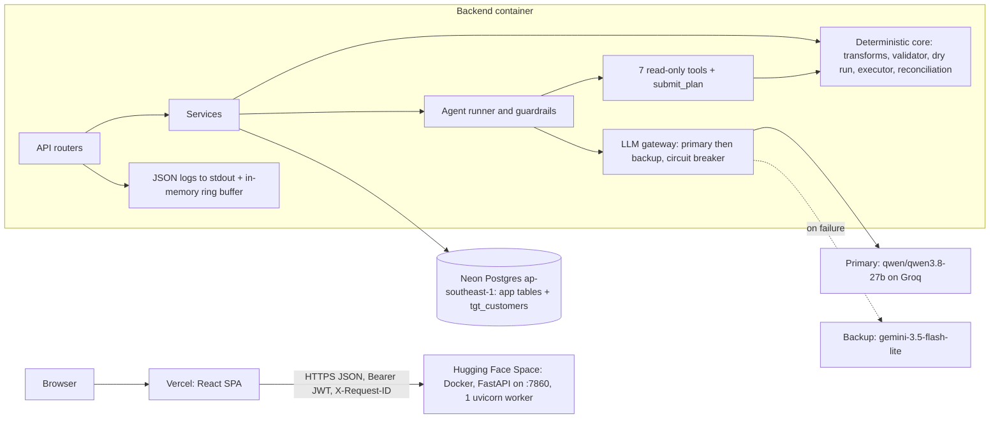

# MigrateIQ

MigrateIQ is a migration planning and reconciliation workbench. An AI agent proposes how to move a legacy CRM customer export into a normalised `customers` table; deterministic code validates, dry-runs, executes, reconciles and rolls back; and a human answers the agent's questions and approves a specific plan version before anything is written.

## Live deployment and demo accounts

| Component | URL |
|---|---|
| Frontend (React on Vercel) | https://aggroso-ten.vercel.app |
| Login page | https://aggroso-ten.vercel.app/login |
| Backend API (FastAPI on a Hugging Face Space) | https://isushant-aggroso.hf.space |
| API docs (OpenAPI) | https://isushant-aggroso.hf.space/api/docs |
| Health | https://isushant-aggroso.hf.space/api/health |

### Demo login credentials

| Role | Username | Password | What this role can do |
|---|---|---|---|
| Operator | `operator` | `migrateiq-demo` | Create projects, run the AI agent, answer questions, edit plans, dry run, execute, retry, import schema screenshots |
| Approver | `approver` | `migrateiq-demo` | Review the approval checklist, approve / reject / revoke plan versions, roll back runs, approve schema imports |

Tip: open the operator in one browser window and the approver in a private window side by side to see the separation of duties.

These are demo-only accounts with no access to anything outside this application. Each reviewer should create their own project; there is no global reset.

The free Hugging Face Space sleeps after about 48 hours without traffic. The first request after a sleep can take a minute while the container starts; the UI shows a "waking server" state.

## Architecture



Responsibility split:

| Deterministic code | LLM | Human |
|---|---|---|
| Schema facts, field profiling, transforms, validation, duplicate detection, counts, hashes, idempotency, writes, rollback, reconciliation | Proposing mappings and transform chains, explaining risks, spotting ambiguity, asking clarification questions | Answering questions, editing the plan, approving a specific version and dry run, executing, retrying, rolling back |

The LLM never computes a count, never writes target data and has no tool that approves or executes.

Stack: Python 3.12 (code kept 3.10-compatible), FastAPI, Pydantic v2, SQLAlchemy 2.0, Alembic, psycopg 3; React 18, Vite, TypeScript, TanStack Query, React Router, Tailwind and Radix-based components.

## Workflow walkthrough

The project workspace is a stepper; each step maps to a page in the UI.

1. Sign in and create a project from one of the bundled datasets (`baseline_60`, `clean_25`, `stress_500`; `overflow_501` exists to prove the 500-record limit). The source snapshot is stored immutably with a checksum.
2. Inputs: inspect the source schema, the fixed target schema, the 12-transform registry and the source records.
3. Agent: start an agent run. The UI polls the run and shows a live trace of every LLM call, tool call, validation result and failover. A successful run creates a DRAFT plan version authored by the agent.
4. Plan: review mappings, confidence, rationale, risks and clarification questions. Answer the questions, acknowledge high-severity risks, edit and save a new version, and diff versions. "Load reference plan" creates a human-authored plan without calling any model.
5. Dry run: a deterministic, read-only pass that reports source, transformed, accepted and rejected counts, with field-level evidence for each rejected record and CSV/JSON export. A determinism check reruns it and compares result hashes.
6. Approve: the approver sees a server-computed checklist (questions answered, high risks acknowledged, a current dry run, separation of duties). Approval binds the plan content hash, the dry-run result hash and the source checksum.
7. Execute: the operator executes with an idempotency key. Rows are inserted in chunks of 100 into `tgt_customers`; conflicts are quarantined with evidence rather than aborting the run. Fault injection (operator only) simulates a mid-run failure so retry can be demonstrated.
8. Reconcile, retry and roll back: reconciliation compares counts, key sets and row hashes against the dry run. Retry processes only unrecorded records. Rollback deletes exactly the rows the run inserted.
9. History: a timeline of plan versions, approvals, runs, attempts, rollbacks and audit events. The Logs page shows recent backend log lines filtered by request id or event.

A 5-minute reviewer path is in [docs/demo-script.md](docs/demo-script.md).

## Local setup

Prerequisites: Python 3.10 or later, Node 22 and npm. Without a `DATABASE_URL` the backend uses a local SQLite file (`migrateiq-dev.db`), which is enough to try the app. Copy `.env.example` to `.env` at the repository root and fill in the keys you have.

### Windows (PowerShell)

```powershell
# Backend
cd backend
python -m venv .venv
.\.venv\Scripts\Activate.ps1
pip install -r requirements.txt
alembic upgrade head
uvicorn app.main:app --port 8000

# Frontend (second terminal, from the repository root)
cd frontend
npm ci
$env:VITE_API_BASE_URL = "http://localhost:8000"
npm run dev
```

### macOS / Linux

```bash
# Backend
cd backend
python3 -m venv .venv
source .venv/bin/activate
pip install -r requirements.txt
alembic upgrade head
uvicorn app.main:app --port 8000

# Frontend (second terminal, from the repository root)
cd frontend
npm ci
VITE_API_BASE_URL=http://localhost:8000 npm run dev
```

The frontend runs on http://localhost:5173, which is the default allowed CORS origin. `VITE_API_BASE_URL` can also be kept in `frontend/.env.local`.

## Configuration

Only three values are secrets. They live in `.env` locally and as Space secrets in production (see [.env.example](.env.example)):

| Variable | Purpose |
|---|---|
| `GROQ_API_KEY` | Primary model provider |
| `GEMINI_API_KEY` | Backup model provider |
| `DATABASE_URL` | Neon pooled connection string (`postgresql://...-pooler.../neondb?sslmode=require&channel_binding=require`) |

Everything else has a default in `backend/app/config.py` and can be overridden through the environment:

| Variable | Default | Notes |
|---|---|---|
| `DATABASE_URL_DIRECT` | derived | Alembic URL; defaults to `DATABASE_URL` with `-pooler` removed |
| `APP_ENV` | `development` | `production` on the Space |
| `LLM_MODE` | `live` | `mock` is for tests only |
| `AGENT_MODE` | `compact` | `compact` or `full` |
| `FORCE_BACKUP` | `false` | Sends agent runs straight to the backup, for demonstrating the backup banner |
| `PRIMARY_LLM_BASE_URL` / `PRIMARY_LLM_MODEL` | `https://api.groq.com/openai/v1` / `qwen/qwen3.8-27b` | |
| `BACKUP_LLM_BASE_URL` / `BACKUP_LLM_MODEL` | `https://generativelanguage.googleapis.com/v1beta/openai/` / `gemini-3.5-flash-lite` | |
| `LLM_TIMEOUT_S` / `BACKUP_LLM_TIMEOUT_S` | `30` / `120` | |
| `JWT_SECRET` | derived | Defaults to an HMAC-SHA256 of `DATABASE_URL` |
| `JWT_TTL_HOURS` | `8` | |
| `DEMO_PASSWORD` | `migrateiq-demo` | Password for both demo accounts |
| `MAX_SOURCE_RECORDS` | `500` | |
| `CORS_ORIGINS` / `CORS_ORIGIN_REGEX` | `http://localhost:5173` / empty | |
| `FAULT_INJECTION_ENABLED` | `false` | `true` on the Space for the retry demo |
| `LOG_LEVEL` | `INFO` | |

The frontend needs one build-time variable, `VITE_API_BASE_URL`. It is not a secret.

## Data model

All business rows are scoped by `project_id`. The mock target, `tgt_customers`, lives in the same database so that target rows and run results commit in one transaction.

| Table | Purpose |
|---|---|
| `users` | The two seeded demo accounts (bcrypt hashes, role) |
| `projects` | One migration workspace: dataset, source checksum, record count |
| `source_records` | Immutable source snapshot, one row per record with a payload hash |
| `plan_versions` | Immutable plan versions (agent or human), status DRAFT / APPROVED / REJECTED / SUPERSEDED, content hash |
| `clarification_answers`, `risk_acknowledgements` | Human input attached to a version; answers carry forward to new versions |
| `approvals` | What exactly was approved: content hash, dry run id and result hash, source checksum, self-approval flag |
| `dry_runs`, `dry_run_records` | Counts, result hash, per-record outcome, transformed row, row hash and error evidence |
| `migration_runs`, `run_attempts`, `run_record_results` | Execution with an idempotency key, attempt history, and a per-record ledger (INSERTED / SKIPPED_EXISTING / QUARANTINED) |
| `rollbacks` | Run-scoped deletions |
| `tgt_customers` | The mock target, with UNIQUE(project_id, legacy_id), UNIQUE(project_id, email) and CHECK constraints |
| `agent_runs`, `agent_steps` | Agent run status, engine, token usage, latency, failover flag, and the step-by-step trace |
| `audit_events` | Append-only audit log; a Postgres trigger blocks UPDATE and DELETE |

A partial unique index allows only one active (not rolled back) run per project. Hashes are SHA-256 over canonical JSON.

## AI workflow and guardrails

Models, named openly here: the primary is `qwen/qwen3.8-27b` on Groq; the backup is `gemini-3.5-flash-lite` through Gemini's OpenAI-compatible endpoint. Both are called through one `openai` SDK client pointed at two base URLs. The UI deliberately shows only "Primary" or "Backup" and a notice when the backup is in use; model ids are never sent to the browser.

Tools: `get_source_schema`, `get_target_schema`, `sample_source_records`, `profile_source_field`, `list_transformations`, `preview_transformation`, `validate_mapping` (all read-only) and `submit_plan`, which can only create a DRAFT version. There is no tool that writes target data, approves or executes. Tool calls outside this allow-list are rejected and logged.

Compact mode (the default, `AGENT_MODE=compact`):

1. The runner calls the read-only tools itself (both schemas, a profile of every source field, the transform registry and five sample rows) and sends the results to the model in one block marked as untrusted data.
2. The model is forced to call `submit_plan` (`tool_choice` names the tool), so it cannot answer in prose.
3. The plan it submits is a compact JSON format; code expands it into the full plan contract (keys, defaults and derived fields), which keeps output within free-tier token limits.
4. A deterministic validator checks fields, transforms, parameter types, required-target coverage and duplicates. If the plan is invalid, the errors go back in a fresh, smaller repair prompt, up to 2 repair rounds. After that the run fails visibly; nothing is auto-accepted.

Full mode (`AGENT_MODE=full`) lets the model call the tools itself over up to 12 turns.

Further guardrails:

- Tool and plan schemas are closed (`additionalProperties: false`) and `source_fields` is required, so invented keys are rejected.
- Transform params that a transform does not accept are stripped with a recorded warning; required params are never invented.
- Failover: if the primary fails (error, rate limit beyond the allowed wait, timeout), the run restarts from scratch on the backup in compact mode. The primary's conversation is never replayed. A circuit breaker and a cached health probe skip a provider that is known to be down.
- Rate limits: agent runs are capped per project and globally per hour.
- Every LLM call, tool call, validation and failover is written to `agent_steps` and shown as the run trace.
- The agent's output is always a DRAFT. Approval and execution remain human actions behind a server-enforced gate.

If both providers are unavailable, the rest of the application still works: load the reference plan, edit it, dry run, approve, execute and roll back.

### Live result

From a single live run on 11 Oct 2026 against `baseline_60`, so treat these as one data point rather than a benchmark:

| Measure | Value |
|---|---|
| Outcome | The primary failed, the run fell back to the backup and succeeded |
| Duration | 107 s |
| LLM calls | 5 |
| Tokens | about 18K input, 4.4K output |
| Mapping accuracy (vs gold mapping) | 1.0 |
| Transform correctness | 1.0 |
| Clarification question recall | 0.2 |

| Plan | Source | Transformed | Accepted | Rejected |
|---|---|---|---|---|
| AI plan (dry run) | 60 | 57 | 22 | 38 |
| Reference plan (dry run) | 60 | 55 | 45 | 15 |

The AI plan mapped every field correctly but asked few of the expected clarification questions and made different choices on some transforms and defaults, which shows up as many more rejected records. This is why a human reviews the dry-run evidence before approving. The scores come from `scripts/eval_agent.py`, which compares a plan with `backend/app/data/gold_mapping.json`.

## Testing

```powershell
# Backend (from backend/, venv active); uses SQLite and the mock LLM
pytest

# Frontend (from frontend/)
npm test
```

- Backend: about 136 pytest tests covering transforms, record validation, the plan validator, dry-run determinism and count invariants, versioning, the approval gate, execution and idempotent retry, reconciliation, rollback, audit, the agent runner (mock LLM, failover, repairs, rejected tools), error envelopes and limits, and a check that no provider or model name reaches API responses. Two tests are Postgres-only (concurrent executes against the partial index, and the append-only audit trigger); they are skipped locally and run in CI against `postgres:16` when `TEST_DATABASE_URL` points at Postgres.
- Frontend: 5 Vitest and React Testing Library tests.
- CI (`.github/workflows/ci.yml`): ruff, Alembic upgrade/downgrade, pytest on Postgres, and gitleaks.
- Live checks, run sparingly to save free-tier quota: `scripts/probe_llm.py` (one call per provider) and `scripts/eval_agent.py`.

Before any live test, check `/api/health` and confirm the `ai` status is `primary` or `backup`, not mock.

## Deployment

### Backend: Hugging Face Space (Docker)

- `backend/` is deployed as-is. `backend/README.md` holds the Space front matter (`sdk: docker`, `app_port: 7860`).
- The image is `python:3.12-slim` running as uid 1000. `start.sh` runs `alembic upgrade head` in a retry loop (Neon may be cold), then starts uvicorn on port 7860 with a single worker. One worker is intentional: the circuit breaker, probe cache and log ring buffer are in memory.
- Deploy with `python scripts/deploy_hf.py`. It reads `HF_TOKEN` and `HF_SPACE_ID` from `.env.deploy` (gitignored), writes `backend/GIT_SHA`, uploads the folder and sets the Space secrets and variables from `.env`. `--wait-only` polls until the Space is running.
- Space secrets: `GROQ_API_KEY`, `GEMINI_API_KEY`, `DATABASE_URL`. Space variables: `APP_ENV=production`, `FAULT_INJECTION_ENABLED=true`, `CORS_ORIGINS` set to the Vercel production URL and optionally `CORS_ORIGIN_REGEX` for preview URLs.

### Database: Neon Postgres

Neon (ap-southeast-1) on the pooled endpoint, with `prepare_threshold=None` for PgBouncer transaction mode and `pool_pre_ping` because Neon scales to zero. Alembic uses the direct (non-pooler) URL.

### Frontend: Vercel

Import the repository with root directory `frontend`, framework preset Vite, and environment variable `VITE_API_BASE_URL=https://isushant-aggroso.hf.space`. `vercel.json` rewrites all routes to `index.html` and sets security headers.

## Completed scope

- One source (`legacy_customers`), one fixed target (`customers`), up to 500 source records per project; larger datasets are rejected with `LIMIT_EXCEEDED`.
- 12 typed, pure transforms: `trim`, `lowercase`, `uppercase`, `split_name`, `parse_date`, `normalize_phone_e164`, `map_values`, `parse_currency_to_cents`, `to_boolean`, `constant`, `default_if_empty`, `concat`.
- Agent planning with tools, compact plan format, validator and repair loop, clarification questions, risk explanations, primary/backup failover with a visible backup notice, and a live run trace.
- Immutable plan versions with diff, answers, risk acknowledgements, and a reference plan path that needs no model.
- Deterministic dry run with field-level evidence, determinism check and export.
- Approval gate bound to the plan hash, dry-run hash and source checksum, with role separation.
- Idempotent chunked execution, quarantine of conflicting rows, fault injection, retry without duplicates, read-only reconciliation and run-scoped rollback.
- History timeline, append-only audit log, structured logs with request ids and an in-app log viewer.
- Schema import from a screenshot: the vision model proposes fields and types, code normalises them (snake_case, type mapping, duplicate and low-confidence flags) and compares them with the provided source schema, and an approver must confirm every type before the schema is accepted. The image is never stored, only its SHA-256.
- Hosted backend, database and frontend; CI.

## Excluded scope

- Production database connectors or live cloud sources.
- User-supplied transform code (there is no `eval`).
- Multi-table or relational migrations, CDC, and updates or upserts of existing target rows (execution is insert-only).
- Distributed or parallel execution, and WebSockets (the UI polls).
- Rolling back a rollback.
- SSO and real user management.
- Arbitrary target schemas.

## Limitations

- Free-tier quotas: the primary allows about 8K tokens per minute on Groq's free tier, and the backup has daily request caps. A burst of agent runs can exhaust both; the reference plan path still works.
- The free Hugging Face Space sleeps after about 48 hours idle, so the first request after a sleep is slow.
- Neon is in ap-southeast-1 while the Space runs elsewhere, so each database round trip from the Space costs roughly 400 ms. The code batches inserts and keeps static inputs in memory to limit round trips.
- Maximum 500 source records per project; execution is synchronous within the request.
- A single uvicorn worker, by design.
- Demo authentication only: two shared seeded accounts with a published password and 8-hour JWTs.
- The live AI result above is from one run; quality will vary between runs and between the primary and backup.

## Further documentation

- [AGENT_USAGE.md](AGENT_USAGE.md): how AI coding agents were used to build this, including mistakes and rejected suggestions.
- [docs/decisions.md](docs/decisions.md): short architecture decision records.
- [docs/demo-script.md](docs/demo-script.md): a 5-minute reviewer walkthrough.
